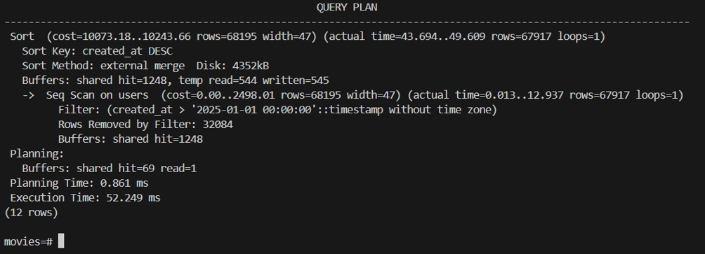
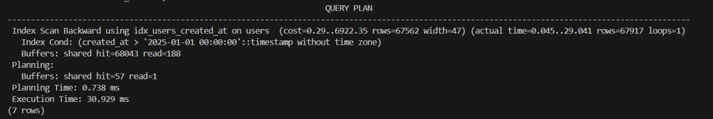
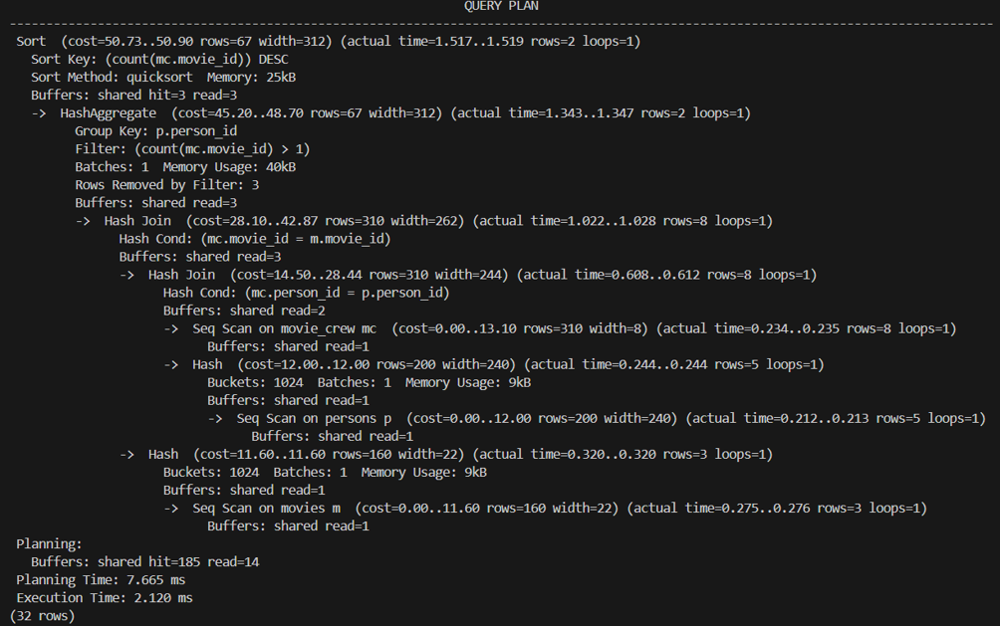
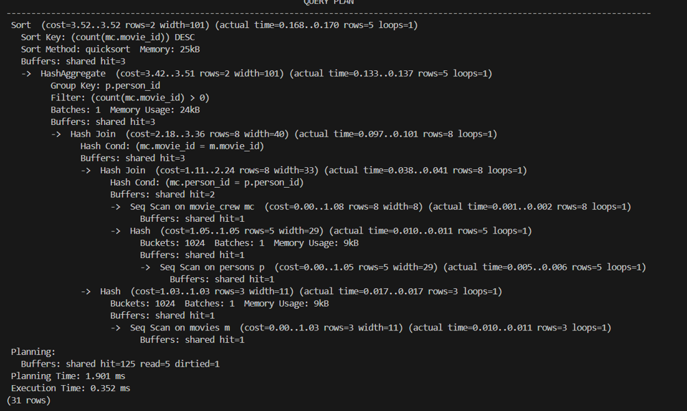
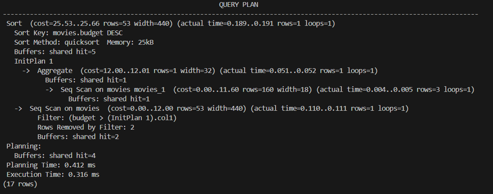
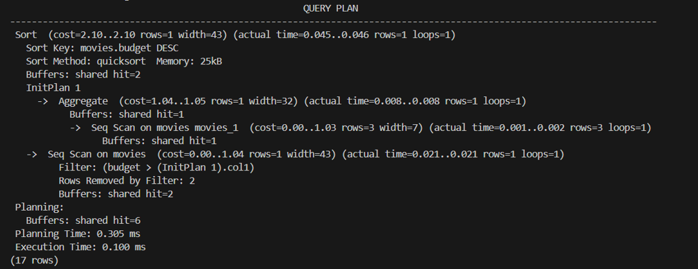

# Звіт з лабораторної роботи №5

## Загальна інформація
- ПІБ студента: Кучерук Максим Сергійович
- Група:ІПЗ-31
- Рівень виконання: 3

## Звіт
### 1. Результати аналізу продуктивності до та після оптимізації
У ході лабораторної роботи було проведено аналіз трьох ключових запитів за допомогою інструкції EXPLAIN ANALYZE, після чого створено відповідні індекси та оновлено статистику (ANALYZE).

Запит 1 (Фільтрація користувачів): Час виконання скоротився з 52.25 ms до 30.93 ms (прискорення ~40.8%), план виконання перейшов від повільного послідовного сканування (Seq Scan) до ефективного індексного (Index Scan).
до:

після:

Запит 2 (movie_crew JOINs): Час виконання зменшився з 2.12 ms до 0.35 ms (прискорення ~83.4% за рахунок оптимізації зв'язків та хеш-з'єднань).
до:

після:

Запит 3 (Підзапит із бюджетами movies): Час виконання знизився з 0.32 ms до 0.10 ms (прискорення ~68.4%).
до:

після:

### 2. Опис створених індексів з обґрунтуванням їх необхідності
Для досягнення оптимальної продуктивності було створено такі типи індексів:

idx_users_created_at — індекс по полю created_at таблиці users. Необхідний для прискорення діапазонних запитів та сортування за датою реєстрації.

idx_movie_crew_person_id та idx_movie_crew_movie_id — індекси зовнішніх ключів у таблиці знімальної групи. Усувають повне сканування таблиць (Seq Scan) під час виконання операцій JOIN.

idx_movies_budget — індекс за полем budget таблиці movies (у сортуванні за спаданням). Прискорює операції порівняння з агрегатними значеннями та сортування.

Часткові індекси (Partial Indexes):

idx_viewers_username на таблиці users з умовою WHERE role = 'viewer' — індексує лише частину рядків, заощаджуючи пам'ять.

idx_big_budget_movies на таблиці movies з умовою WHERE budget > 100000000 — оптимізує пошук високобюджетних проєктів.

Унікальний індекс матеріалізованого представлення (idx_movie_yearly_release): Забезпечує унікальність рядків та дозволяє оновлювати представлення у фоновому режимі (REFRESH MATERIALIZED VIEW CONCURRENTLY).
### 3. SQL код всіх створених представлень та тригерів
#### Представлення (Views)
``` SQL
-- 1. Просте представлення для користувачів-глядачів
CREATE VIEW active_viewers AS
SELECT user_id, username, email, created_at
FROM users
WHERE role = 'viewer';

-- 2. Складне представлення з агрегацією для кінематографістів
CREATE VIEW movie_person_stats AS
SELECT 
    p.person_id,
    p.first_name || ' ' || p.last_name AS full_name,
    COUNT(DISTINCT mc.movie_id) AS total_movies,
    COALESCE(ROUND(AVG(m.budget), 2), 0) AS avg_movie_budget,
    MAX(m.release_year) AS latest_release_year
FROM persons p
LEFT JOIN movie_crew mc ON p.person_id = mc.person_id
LEFT JOIN movies m ON mc.movie_id = m.movie_id
GROUP BY p.person_id, p.first_name, p.last_name;

-- 3. Оновлюване представлення через правила (RULE)
CREATE OR REPLACE VIEW active_viewers_view AS
SELECT user_id, username, email, role
FROM users
WHERE role = 'viewer';

CREATE OR REPLACE RULE viewer_contacts_update AS
ON UPDATE TO active_viewers_view
DO INSTEAD
    UPDATE users
    SET email = NEW.email,
        role = NEW.role
    WHERE user_id = OLD.user_id;
``` 
#### Системи логування та тригери
``` SQL
-- Створення таблиці аудит-логу
CREATE TABLE IF NOT EXISTS audit_log (
    log_id SERIAL PRIMARY KEY,
    table_name VARCHAR(50) NOT NULL,
    operation VARCHAR(10) NOT NULL,
    record_id INTEGER,
    old_values JSONB,
    new_values JSONB,
    changed_by VARCHAR(100),
    changed_at TIMESTAMP DEFAULT NOW()
);

-- Функція та тригер валідації email (BEFORE)
CREATE OR REPLACE FUNCTION validate_user_email()
RETURNS TRIGGER AS $$
BEGIN
    IF NEW.email !~ '^[A-Za-z0-9._%+-]+@[A-Za-z0-9.-]+\.[A-Za-z]{2,}$' THEN
        RAISE EXCEPTION 'Invalid email format: %', NEW.email;
    END IF;
    RETURN NEW;
END;
$$ LANGUAGE plpgsql;

DROP TRIGGER IF EXISTS trg_validate_email ON users;
CREATE TRIGGER trg_validate_email
BEFORE INSERT OR UPDATE ON users
FOR EACH ROW
EXECUTE FUNCTION validate_user_email();

-- Комплексна функція та тригер аудиту (INSERT, UPDATE, DELETE)
CREATE OR REPLACE FUNCTION comprehensive_audit_log()
RETURNS TRIGGER AS $$
BEGIN
    IF TG_OP = 'DELETE' THEN
        INSERT INTO audit_log (table_name, operation, record_id, old_values, changed_by)
        VALUES (TG_TABLE_NAME, TG_OP, OLD.user_id, row_to_json(OLD)::jsonb, current_user);
        RETURN OLD;
    ELSIF TG_OP = 'UPDATE' THEN
        INSERT INTO audit_log (table_name, operation, record_id, old_values, new_values, changed_by)
        VALUES (TG_TABLE_NAME, TG_OP, OLD.user_id, row_to_json(OLD)::jsonb, row_to_json(NEW)::jsonb, current_user);
        RETURN NEW;
    ELSIF TG_OP = 'INSERT' THEN
        INSERT INTO audit_log (table_name, operation, record_id, new_values, changed_by)
        VALUES (TG_TABLE_NAME, TG_OP, NEW.user_id, row_to_json(NEW)::jsonb, current_user);
        RETURN NEW;
    END IF;
END;
$$ LANGUAGE plpgsql;

DROP TRIGGER IF EXISTS trg_comprehensive_audit ON users;
CREATE TRIGGER trg_comprehensive_audit
AFTER INSERT OR UPDATE OR DELETE ON users
FOR EACH ROW
EXECUTE FUNCTION comprehensive_audit_log();
``` 
### 4. Перевірка роботи тригерів
Успішна вставка коректного запису:

Команда:

``` SQL
INSERT INTO users (username, password_hash, email, role) 
VALUES ('test_user', 'hash_12345', 'test@example.com', 'viewer');
``` 
Результат: Запис успішно додано (INSERT 0 1), спрацював тригер аудиту.

Блокування невалідного email:

Команда:

``` SQL
INSERT INTO users (username, password_hash, email, role) 
VALUES ('invalid_user', 'hash_67890', 'invalid-email', 'viewer');
``` 
Результат: Спрацював захисний механізм тригера валідації:ERROR: Invalid email format: invalid-emailCONTEXT: PL/pgSQL function validate_user_email() line 4 at RAISE

Вибірка з таблиці audit_log:
Після перевірки операцій таблиця містить актуальні зафіксовані події з даними у форматі JSONB.

### 5. Документація системи прав доступу для різних ролей
ДДля забезпечення безпеки та розмежування прав було реалізовано ієрархічну модель ролей:

readonly_role: Має права підключення до бази даних (CONNECT, USAGE на схему public) та право читання (SELECT) усіх таблиць схеми. Користувач-учасник: viewer_user.

readwrite_role: Наслідує права readonly_role та додатково володіє правами модифікації даних (INSERT, UPDATE, DELETE). Користувач-учасник: moderator_user.

admin_role: Наслідує права readwrite_role та має повні адміністративні привілеї (ALL PRIVILEGES). Користувач-учасник: admin_user.

Користувач movie_viewer: Спеціальний користувач із точковими обмеженнями на читання лише дозволених таблиць та представлень (active_viewers, movie_person_stats), без прав на запис (спроба виконання INSERT повертає ERROR: permission denied for table users).

### 6. Висновки щодо покращення продуктивності та рекомендації
Ефективність індексації: Впровадження цільових та часткових індексів дозволило суттєво зменшити час виконання складних запитів, оптимізувати операції об'єднання таблиць (JOIN) та знизити навантаження на дискову підсистему.

Безпека та цілісність даних: Тригери типу BEFORE надійно блокують некоректні дані ще на етапі спроби їх запису, а тригери AFTER спільно з таблицею audit_log забезпечують повну прозорість і відстежуваність усіх транзакцій у системі.

Рекомендації:

Регулярно запускати процедуру обслуговування бази даних (ANALYZE та REINDEX) для підтримки актуальності статистичних даних оптимізатора.

Використовувати механізми ієрархічного управління ролями (RBAC) замість надання персональних прав окремим користувачам, що значно спрощує адміністрування безпеки у великих базах даних.
