# Звіт з лабораторної роботи №4

## Загальна інформація
- ПІБ студента: Кучерук Максим Сергійович
- Група:ІПЗ-31
- Варіант (предметна область): Кінематограф 
- Рівень виконання: 3

## Опис предметної області
Об'єктом моделювання є інформаційна система «Кінокаталог», призначена для зберігання, обробки та аналізу даних про фільми, знімальну групу, бюджети, рейтинги та користувачів системи.

Предметна область охоплює такі ключові сутності та взаємозв'язки:

Фільми (movies): зберігають базову інформацію про кінострічку (назву, рік випуску, тривалість, рейтинг, бюджет).

Кінематографісти / Особи (persons): містять дані про акторів, режисерів, сценаристів тощо (ім'я, прізвище, країна).

Ролі та знімальна група (roles, movie_crew): зв'язують фільми з конкретними кінематографістами із зазначенням їхніх ролей у проєкті.

Користувачі та безпека (users): забезпечують розмежування ролей та доступ до системи.

Журнал аудиту (activity_log): фіксує всі ключові операції користувачів з метою контролю та безпеки.

## Концептуальна модель
Концептуальна схема проєкту розроблена у вигляді ER-діаграми, яка відображає зв'язки між сутностями «Фільми», «Особи», «Ролі», «Користувачі» та «Логи аудиту» у нотации сутність-зв'язок (Entity-Relationship).
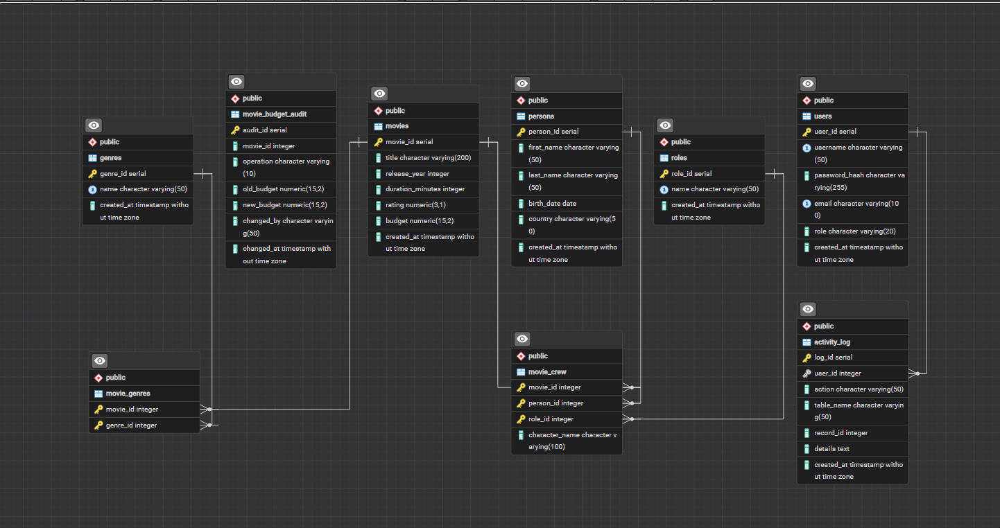

## Логічна схема
Логічна структура реляційної бази даних складається з таких нормалізованих таблиць та зв'язків:

movies (PK: movie_id) — зберігає атрибути фільмів.

persons (PK: person_id) — зберігає інформацію про людей кіноіндустрії.

roles (PK: role_id) — довідник професій/ролей (актор, режисер тощо).

movie_crew (PK: crew_id, FK: movie_id, person_id, role_id) — зв'язкова таблиця «багато до багатьох» між фільмами та персоналом.

users (PK: user_id) — таблиця облікових записів користувачів та адміністраторів.

activity_log (PK: log_id, FK: user_id) — таблиця для системного аудиту та логування дій.

Також створено допоміжне представлення (View) person_statistics для агрегованого аналізу кількості фільмів, середніх бюджетів та рейтингів по кожному кінематографісту.

## Реалізація в PostgreSQL
Для створення структури бази даних було використано модульні SQL-скрипти, які виконуються послідовно. Основні скрипти включають створення таблиць, представлень, індексів, а також процедуру логування:

``` SQL

-- Приклад створення основної таблиці фільмів
CREATE TABLE movies (
    movie_id SERIAL PRIMARY KEY,
    title VARCHAR(150) NOT NULL,
    release_year INT CHECK (release_year >= 1888),
    duration_minutes INT CHECK (duration_minutes > 0),
    rating NUMERIC(3,1) CHECK (rating >= 0 AND rating <= 10),
    budget NUMERIC(15,2)
);

-- Функція для логування операцій (Аудит)
CREATE OR REPLACE FUNCTION log_activity(
    p_user_id INT,
    p_action VARCHAR,
    p_table_name VARCHAR,
    p_record_id INT,
    p_details TEXT DEFAULT NULL
) RETURNS VOID AS $$
BEGIN
    INSERT INTO activity_log (user_id, action, table_name, record_id, details)
    VALUES (p_user_id, p_action, p_table_name, p_record_id, p_details);
END;
$$ LANGUAGE plpgsql;
```

## Налаштування Docker
Для ізольованого та стабільного середовища бази даних використовується контейнеризація за допомогою Docker та docker-compose.

Конфігурація docker-compose.yml піднімає офіційний образ PostgreSQL із налаштованими змінними середовища (іменем бази, користувачем та паролем) і прокидає стандартний порт 5432 на локальну машину.

Команда запуску контейнера: docker-compose up -d (або через Docker Desktop).

## SQL-запити
У проєкті реалізовано повну колекцію SQL-запитів різного рівня складності для аналізу даних про кінематограф:

1. Простий запит на вибірку даних з однією таблицею (фільтрація та сортування)
Фільми, випущені з 2010 року включно, відсортовані за рейтингом у спадному порядку:

``` SQL
SELECT title, release_year, rating, budget
FROM movies
WHERE release_year >= 2010
ORDER BY rating DESC;
```
2. Запит з об'єднанням таблиць для отримання пов'язаних даних
Отримання фільмів разом із їхніми жанрами (через зв'язкову таблицю movie_genres):

``` SQL
SELECT 
    m.title AS movie_title,
    m.release_year,
    g.name AS genre_name
FROM movies m
INNER JOIN movie_genres mg ON m.movie_id = mg.movie_id
INNER JOIN genres g ON mg.genre_id = g.genre_id
ORDER BY m.title;
```
3. Агрегатний запит для обчислення статистики
Статистика по кінематографістах (кількість фільмів, у яких брала участь людина, та середній бюджет цих фільмів з використанням GROUP BY та HAVING):

``` SQL
SELECT 
    p.first_name || ' ' || p.last_name AS person_name,
    COUNT(mc.movie_id) AS movies_participated,
    ROUND(AVG(m.budget), 2) AS avg_movie_budget
FROM persons p
INNER JOIN movie_crew mc ON p.person_id = mc.person_id
INNER JOIN movies m ON mc.movie_id = m.movie_id
GROUP BY p.person_id, p.first_name, p.last_name
HAVING COUNT(mc.movie_id) > 0
ORDER BY movies_participated DESC;
```
4. Підзапит для складних умов вибірки
Фільми, чий бюджет перевищує середній бюджет усіх фільмів у базі даних:

``` SQL
SELECT title, release_year, budget
FROM movies
WHERE budget > (SELECT AVG(budget) FROM movies)
ORDER BY budget DESC;
```
5. Складний запит з кількома JOIN (повна інформація про знімальну групу)
Детальна інформація: назва фільму, ім'я учасника знімальної групи, його роль (посада) та ім'я персонажа (якщо це актор):

``` SQL
SELECT 
    m.title AS movie_title,
    m.release_year,
    p.first_name || ' ' || p.last_name AS crew_member,
    r.name AS role_type,
    COALESCE(mc.character_name, '—') AS character_name
FROM movies m
INNER JOIN movie_crew mc ON m.movie_id = mc.movie_id
INNER JOIN persons p ON mc.person_id = p.person_id
INNER JOIN roles r ON mc.role_id = r.role_id
ORDER BY m.title, r.name;
```
## Консольний застосунок
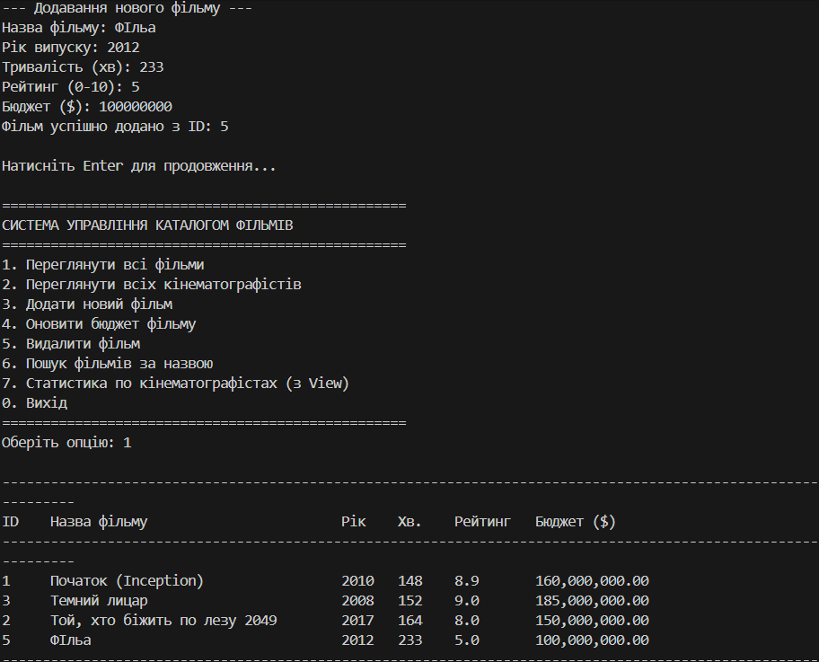
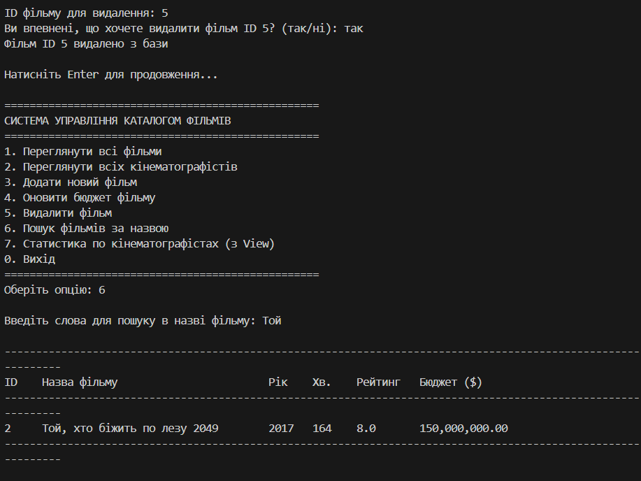
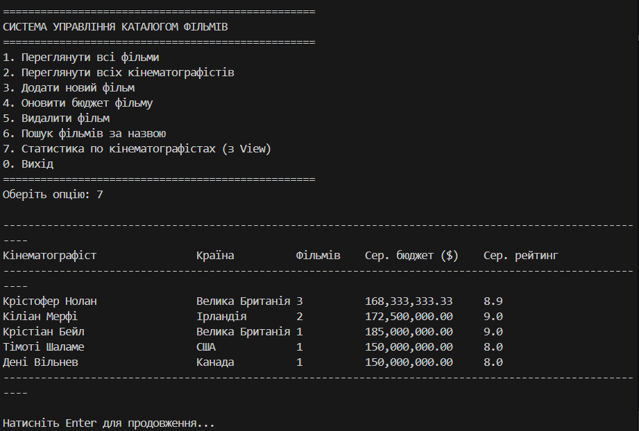

## Вебзастосунок 
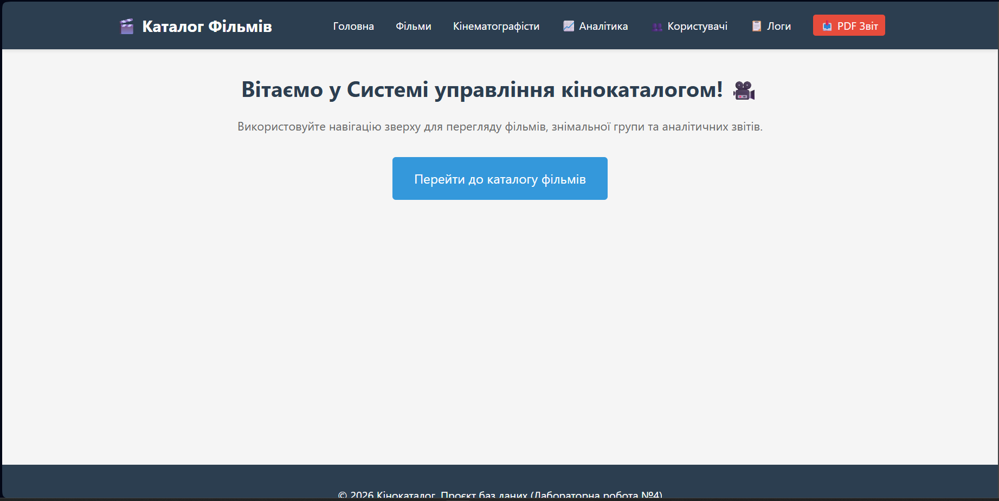
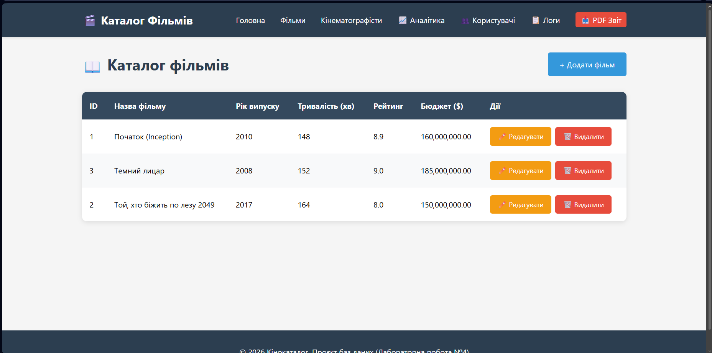
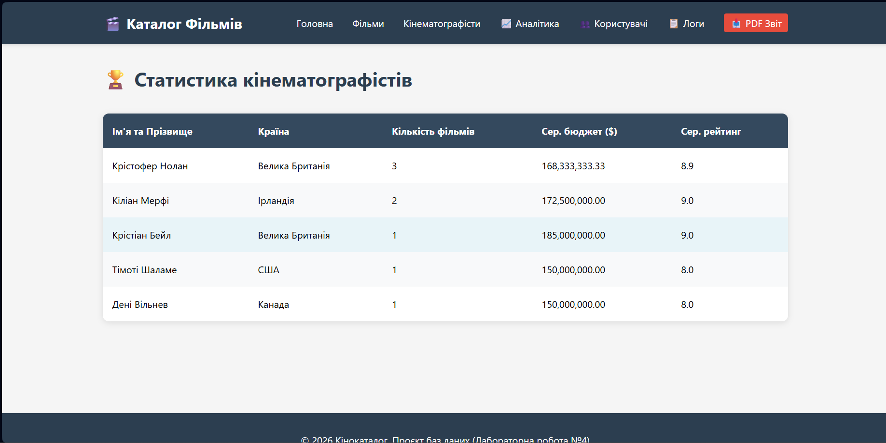
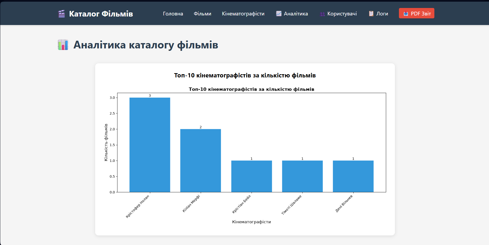
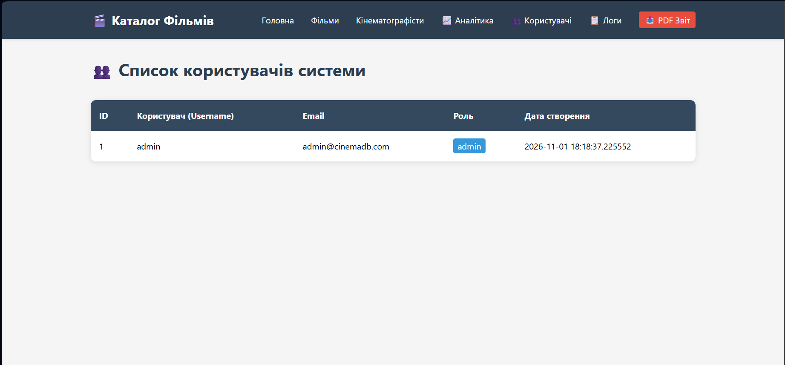
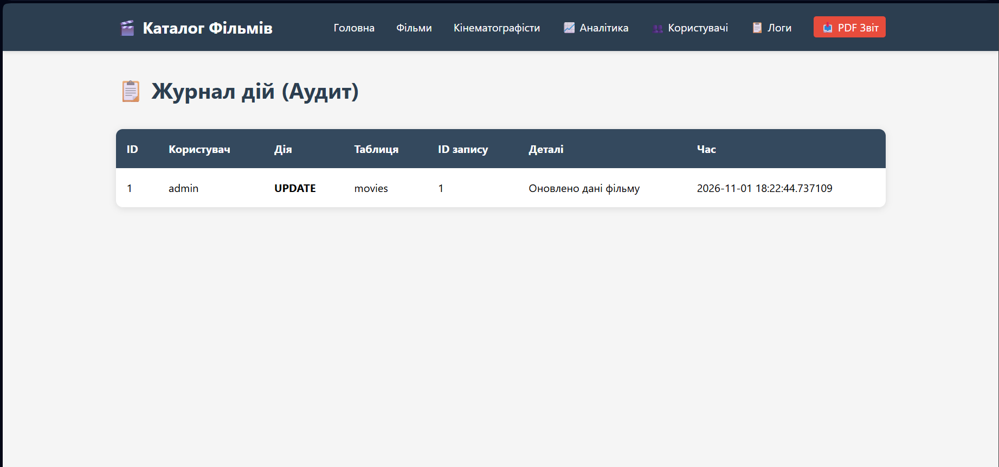
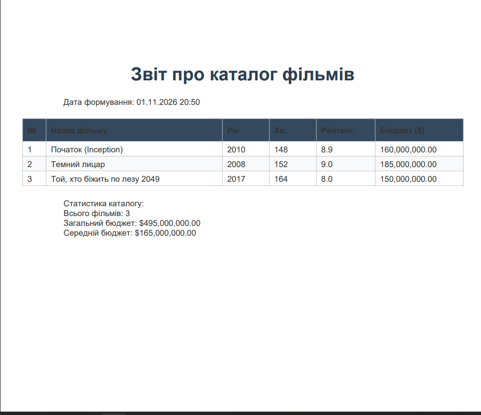

## Розширена функціональність 
Для досягнення 3-го рівня складності було реалізовано низку розширених можливостей:

Система аутентифікації та користувачів (users): Створено таблицю облікових записів із ролями та дефолтним адміністратором.

Журнал аудиту дій (activity_log та log_activity): Автоматизоване логування операцій створення, оновлення та видалення записів.

Генерація PDF-звітів (reports.py): Використання бібліотеки ReportLab з підтримкою української кирилиці (системний шрифт Arial) для формування якісних звітів про каталог фільмів із підрахунком загальної статистики.

REST API (api.py): Захищені за допомогою API-ключів (X-API-Key) ендпоінти для програмного отримання та створення записів про фільми у форматі JSON.

Візуалізація даних (charts.py): Інтеграція бібліотеки matplotlib для генерації аналітичних графіків та діаграм (розподіл бюджетів та топ авторів), які динамічно виводяться на вебсторінці аналітики.

## Висновки
У ході виконання проєкту було успішно розроблено повноцінну інформаційну систему управління кінокаталогом.

Що було зроблено: спроєктовано реляційну базу даних у PostgreSQL, налаштовано середовище Docker, створено консольний CRUD-інтерфейс та сучасний вебзастосунок на Flask із розширеним функціоналом (PDF-звіти, API, графіки, аудит).

Які навички здобуто: закріплено навички написання складних SQL-запитів, процедур та тригерів у PostgreSQL, побудови вебдодатків на Python/Flask, роботи з бібліотеками візуалізації (matplotlib) та генерації документів (ReportLab), а також керування контейнерами через Docker.

Які труднощі виникли: у процесі інтеграції PDF-звітів було успішно вирішено проблему рендерингу української кирилиці шляхом підключення системних шрифтів TrueType, оптимізовано роботу з'єднань із базою даних після перезапуску контейнерів Docker. Також на протязі виконування роботи виникали труднощі з неправильно написаним кодом, які швидко виправлялись.